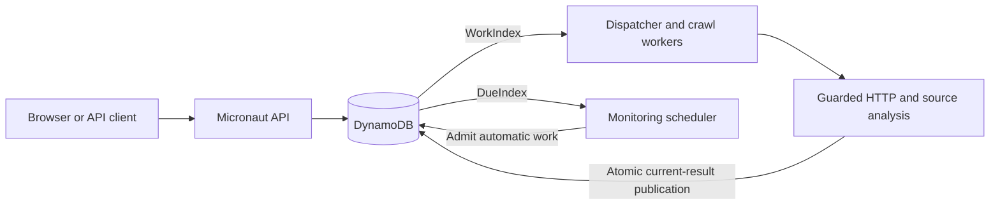

# llms-txt-joaquin-duran

A web application that turns public website URLs into downloadable [llms.txt](https://llmstxt.org/) files and checks for changes automatically.
Submit up to 1,000 URLs, follow each result independently, preview selected pages, and download individual files or a batch ZIP.

**Deployment status:** available locally; public hosting is pending.

## Quick start

Install Docker with Compose v2, then run from the repository root:

```sh
docker compose up --build -d --wait --wait-timeout 180
```

Open **http://localhost:8080**. Compose starts DynamoDB Local, initializes its table and indexes, and starts the application with the React frontend.
The first build requires internet access. No host Java, Node, AWS account or real credentials are needed.

```sh
docker compose logs -f app
docker compose down
```

Stopping or restarting preserves the database volume. **`docker compose down -v` deletes the local database.**

## Usage and API

Paste one URL per line in the web form. The server processes accepted work asynchronously; closing the browser does not cancel it.
Results can be downloaded individually or together with **Download batch (.zip)**.

The same flow is available over HTTP:

```sh
# Submit a website. Access to a particular public site may change over time.
curl -i http://localhost:8080/api/batches \
  -H 'Content-Type: application/json' \
  -d '{"urls":["https://www.iana.org/help/example-domains"],"force":false}'

# Copy batchId from the JSON response and poll for completion.
BATCH_ID=replace-with-batch-id
curl "http://localhost:8080/api/batches/$BATCH_ID?offset=0&limit=100"

# Copy an available item's artifactUrl to download its current file.
ARTIFACT_URL=/artifacts/replace-with-identity-id/llms.txt
curl --fail -OJ "http://localhost:8080$ARTIFACT_URL"

# Download up to 100 results once that page is complete.
curl --fail -OJ "http://localhost:8080/api/batches/$BATCH_ID/download?offset=0&limit=100"
```

All submissions persist all inputs before returning `202 Accepted` with a tracking ID and `Location` header. Inputs wait durably when admission capacity is full. Accepted inputs and queued runs have no waiting deadline; the 180-second crawl budget starts when a worker claims a run.
Cache and active-work reuse are resolved during background admission, including when execution capacity is full. Up to five open batches are allowed by default; a full receipt backlog returns `429 BACKLOG_FULL` with `Retry-After`.
A batch becomes `COMPLETED` when every row is terminal; inspect each item's `status` and `error`, since some rows may have failed.
`batchId` tracks the submission, `runId` tracks an execution, and `identityId` identifies the normalized website request.
Result pages contain at most 100 rows, with `totalItems`, `admittedItems` and `nextOffset`; use that offset for the next page. `PENDING` means an input is stored but has not yet entered the crawl queue.

A compatible result is fresh for 15 minutes from its accepted observation start. Duplicate requests reuse known compatible active work.
`"force":true` bypasses freshness, while retaining active-work reuse, cooldown, quotas and crawl safety limits.

Files have descriptive names derived from the website host and path. The ZIP includes one available file per input row and `batch-summary.json` with errors and downloaded hashes.
Downloads serve the latest accepted result; batches do not pin historical files. Each ZIP covers one requested page and includes its continuation in the summary.
Execution details expire seven days after termination. If those details have been removed, a settled row is shown as `EXPIRED`; its current website file remains available when present.
A ready page can download while later pages are still processing. An unfinished page or one with no downloadable files returns `409`.

| Endpoint | Purpose |
| --- | --- |
| `POST /api/batches` | Submit 1–1,000 URLs and optional `force` |
| `GET /api/batches/{batchId}` | Read a bounded page of ordered results, errors and download URLs |
| `GET /api/runs/{runId}` | Read execution status, phase and counters |
| `GET /api/batches/{batchId}/download` | Download a ZIP page using `offset` and `limit` (maximum 100) |
| `GET /api/crawls/{identityId}` | Read the current result, selected resources and monitoring status |
| `GET /api/crawls/{identityId}/resources` | Read selected-resource metadata |
| `GET /artifacts/{identityId}/llms.txt` | Download the current file; supports hash ETags |
| `POST /api/crawls/{identityId}/refresh` | Request forced regeneration |
| `POST /api/crawls/{identityId}/monitoring` | Enable or disable checks with `{"enabled":true}` or `false` |

Malformed requests return `400`; oversized bodies return `413`. Rate limits return `429` with `Retry-After`; storage or executor saturation returns `503`.
URL rejection, source failures and force cooldowns may appear as individual row errors in an otherwise successful HTTP response.

### Automatic updates

The first accepted result starts a seven-day monitoring window. Automatic checks are enabled when a monitoring slot is available; otherwise generation still succeeds with monitoring inactive.
Checks run about daily, with up to 10% deterministic positive jitter.
Failed checks back off from 15 minutes up to the normal interval and preserve the last accepted file. Failed result rows retain available downloads, and the result view explains preserved files.
Source hashes detect changes in cleaned text, metadata and links; file revisions change only when the generated bytes change.

Monitoring runs on the server, independently of browser polling. Disable preserves the file and already admitted work.
Enable resumes the original unexpired window; it does not extend or renew it. Manual refresh remains available after monitoring expires.

## Architecture and design decisions

One Kotlin/Micronaut JVM serves React and the HTTP API. One DynamoDB table stores work, batch decisions, current results and scheduling state.



- **Durable asynchronous work:** large receipts store input chunks before responding; a background processor admits them gradually into the existing work queue. Conditional claims and recovery handle interrupted runs; source requests are not exactly-once.
- **DynamoDB:** known point reads and two sparse indexes cover result lookup, work discovery and scheduling without Scan. Conditional transactions protect publication and quotas; explicit expressions add complexity compared with a relational model.
- **Deterministic generation:** HTML, Markdown and recognized JSON evidence, relevance ranking and category/family diversity select representative pages. The output is reproducible, with no model API dependency or generation fees; heuristics can miss relevant content.
- **Current result only:** file bytes, selected-page evidence and hashes live in one `CRAWL#identityId / RESULT` item. Acceptance updates the result, metadata, terminal run and capacity atomically. Failed or incomplete updates preserve the previous result.
- **Bounded execution:** 12 crawl workers by default, a separate bounded API executor, per-origin coordination and explicit request, size and time budgets. Local coordination keeps operation simple but assumes one application instance.

See the [technical architecture](docs/architecture.md) for the request lifecycle, DynamoDB model, concurrency guarantees, security and extension points.

The backend uses Java 25, Kotlin, Micronaut, AWS SDK, OkHttp, Jsoup and Crawler Commons; the frontend uses React, TypeScript and Vite.
Dependency versions are pinned in the build files and lockfile. Docker builds the frontend into the application distribution and runs it as a non-root user.

## Configuration

Defaults work with Compose. Copy `.env.example` to the ignored `.env` only to override them; host JVM commands require exported environment variables.
The complete list is in [.env.example](.env.example). Main controls:

| Variable | Default | Meaning |
| --- | --- | --- |
| `PORT` | `8080` | Application port |
| `APP_ENV` | `local` | Local or AWS storage mode |
| `DYNAMODB_TABLE` | `llms-txt-local` | Application table |
| `DYNAMODB_ENDPOINT` | Local: `http://localhost:8000` | Compose uses `http://dynamodb:8000`; omit in AWS mode |
| `AWS_REGION` | `us-east-1` | AWS SDK region |
| `MAX_BATCH_URLS` / `MAX_OPEN_BULK_BATCHES` | `1000` / `5` | Inputs per request / open bulk receipts |
| `MAX_API_BODY_BYTES` / `MAX_URL_BYTES` | `2097152` / `2048` | HTTP body / individual input UTF-8 byte limits |
| `MAX_CONCURRENT_CRAWLS` | `12` | Crawl workers |
| `MAX_OUTSTANDING_RUNS` / `MAX_MONITORED_IDENTITIES` | `40` / `50` | Durable work and monitoring quotas |
| `MAX_PAGES` / `MAX_SELECTED_RESOURCES` | `10` / `10` | Exploration page attempts / selected resources; previous selections may require additional revalidation |
| `MAX_CRAWL_DURATION_SECONDS` / `MAX_REQUESTS` | `180` / `60` | Crawl time and HTTP request-attempt budgets |
| `MAX_RESPONSE_BYTES` | `2097152` | Maximum decompressed source response: 2 MiB |
| `MONITOR_INTERVAL_SECONDS` / `MONITOR_WINDOW_SECONDS` | `86400` / `604800` | Check interval and monitoring duration |
| `JAVA_OPTS` | Docker: `-Xmx384m -Dfile.encoding=UTF-8` | JVM options; total process memory exceeds heap size |

API client identity uses the direct socket peer by default. Configure `TRUSTED_PROXY_CIDRS` only for a verified ingress proxy that overwrites `X-Real-IP`; arbitrary forwarding headers never establish trust.

Fresh tables use one shard per index. When reusing an older table, retain its initialized `WORK_INDEX_SHARDS` and `DUE_INDEX_SHARDS` values.
Initialization/readiness rejects incompatible metadata and never resets counters. Dummy local credentials are supplied by Compose; keep real credentials outside Git and frontend variables.

The ten-page exploration limit may be exceeded only to revalidate previously selected sources. This bounded exception retains the HTTP request, time, response-size and frontier budgets, reports `BASELINE_REVALIDATION`, and prevents older larger selections from becoming permanently unrefreshable. Failed revalidation still preserves the accepted file and identifies a failed resource without its query string.

Public defaults allow six submissions/minute/client and 30/minute globally, 120 reads/minute/client and three force requests/five minutes/client, using token buckets with bounded bursts. URL budgets additionally allow 1,000 inputs/minute/client and 2,000/minute globally.

### Host development

Optional: install JDK 25 and Node 22.12+. Stop the Compose application with `docker compose stop app` to avoid a port conflict and a second scheduler.
Start DynamoDB with `docker compose up -d dynamodb`, then run `npm ci && npm run build` in `frontend/`, then `./gradlew run --args=--init-local` and `./gradlew run` from the root.
Run `npm run dev` in a separate frontend terminal for Vite at http://localhost:5173, which proxies API requests to port 8080.

## Testing

Run the complete Docker-based verification:

```sh
./scripts/verify.sh
```

This builds the application, reruns backend unit/integration tests against DynamoDB Local, verifies storage, admission, bulk backlog, crawl and monitoring restart scenarios, and proves automatic source updates with a controlled fixture.
The frontend build includes its tests. Tests cover URL safety, selection quality, cache/force/shared work, publication races, last-known-good behavior, quota release, monitoring and downloads.
Public websites and production AWS are not test dependencies. Test fixtures and accelerated monitoring are excluded from the runtime distribution.
The script restarts local services and preserves the application database volume. Set `VERIFY_EVIDENCE_DIR` to choose the automatic-update evidence directory.

For focused UI interaction tests on desktop and mobile, run `npm ci`, `npx playwright install chromium`, then `npm run test:browser` in `frontend/` with Node 22.12+. These use a controlled API fixture and do not crawl public websites.

For an optional controlled 100-site workload:

```sh
./scripts/benchmark-crawl.sh /tmp/llms-txt-load
```

Recorded locally on October 15, 2026 with synthetic sources, identical output and unchanged per-origin limits:

| Workers | Completed | Processing time |
| --- | --- | --- |
| 4 | 100/100 | 107.516 s |
| 8 | 100/100 | 56.414 s |

The benchmark uses isolated tables and explicitly raises their quotas. These observations include other concurrent local verification; they do not establish public API throughput or AWS capacity.
For formatting, use `./gradlew formatKotlin` and `./gradlew checkKotlinStyle`.

## Deployment

Public deployment is pending. The intended topology is Railway HTTPS → one application JVM → one AWS DynamoDB table.
Use the existing Dockerfile, `APP_ENV=aws`, an explicit AWS region/table, no endpoint override, and externally supplied least-privilege runtime credentials.
The table needs string `pk`/`sk` keys and `KEYS_ONLY` indexes `WorkIndex` (`workPk`/`workSk`) and `DueIndex` (`duePk`/`dueSk`).
Production preparation includes a minimal CloudFormation table template, a guarded administrative bootstrap command, a scoped runtime IAM policy and Railway configuration. Follow the [deployment guide](docs/deployment.md) and [.env.production.example](.env.production.example). Credentials remain outside Git; confirm Railway ingress trust and use stop-before-start releases before exposing the service.
The live URL and screenshots/video will be added after public deployment is verified. GitHub autodeploy must remain disabled for the single-JVM release procedure.

Health checks are `GET /health/liveness` and `GET /health/readiness`; readiness validates storage and returns `503` when unavailable, sharing probe results for at most two seconds. Health requests are independent of API rate limits.
Keep the application running for automatic checks. Accepted results persist in DynamoDB and do not require an application filesystem volume.

## Supported sources

HTML and CommonMark Markdown sources share the same bounded discovery, ranking and generation flow. JSON support covers OpenAPI 3.x/Swagger 2.0 descriptions and document/catalog objects with a `title` or `name`, descriptive text and optional explicit links. Catalog entries can appear in `items`, `products`, `categories`, `itemListElement` or `@graph`. API operation descriptions are read as documentation; operations are never called and external references are not resolved.

Missing or generic media types use a conservative content check for recognizable HTML, Markdown or JSON. Binary formats and unrecognized JSON structures remain unsupported. Errors identify the received media type or JSON parsing/structure failure.

Short standalone sources can qualify with at least 50 cleaned characters and an observed descriptive title, without child pages. Limited content is reported as a warning. Empty JavaScript shells, short client-side redirect placeholders, detected challenge/error pages and incomplete revalidation of previous selections remain unacceptable.

Robots `4xx` responses permit a normal source request, except `429`, which retains backoff. Robots server/network failures defer crawling; explicit disallow rules remain enforced. A source page returning `403` still fails normally. Pipeline `deterministic-v4` separates these extraction rules from earlier cached observations; existing accepted files remain downloadable.

## Known limitations

- JavaScript rendering, authenticated sites and CAPTCHA handling are unsupported. Empty app shells can fail without useful content.
- Crawls are bounded and remain within the effective page origin. Robots rules, redirects, timeouts and response limits can exclude important pages; selection is representative, not exhaustive.
- All source requests use `LlmsTxtGenerator/0.4`, validate public DNS/IP destinations and redirects, honor robots/per-origin spacing and back off on HTTP 429/503.
- Generation and automatic-monitoring quotas are independent. At most 50 identities are monitored by default; additional files remain downloadable and can enable monitoring later if a slot becomes available within their original window.
- One JVM is supported. Origin coordination and API rate buckets are local. Forwarded client addresses require a verified trusted proxy configuration; otherwise the socket peer is used. Multiple replicas need shared coordination.
- Results are publicly readable by ID. There are no user accounts, ownership verification or historical downloads. Website owners must publish the generated file on their own domain.
