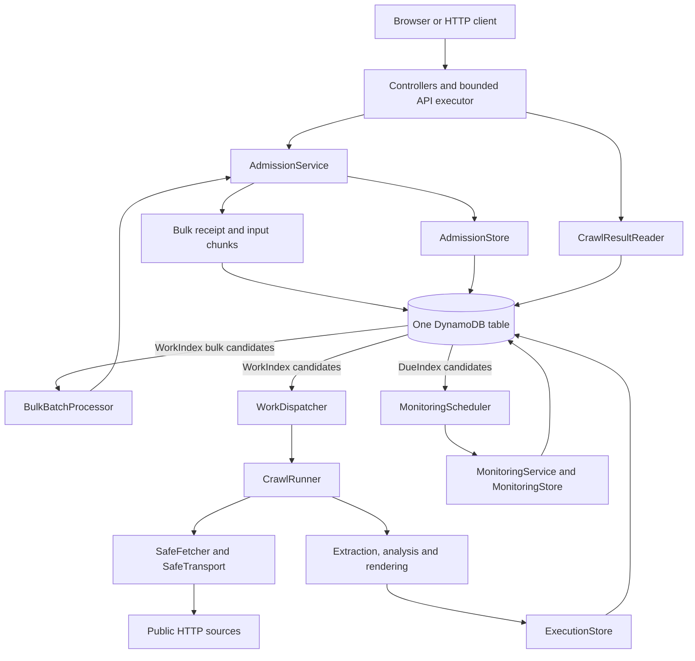
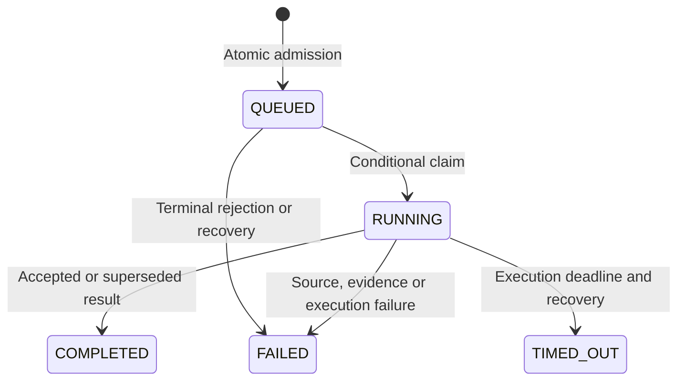

# Technical architecture

This document describes the implemented application, its persistence guarantees and its operating limits.
Start with the [README](../README.md) for setup, API examples and verification commands.

## Runtime and responsibility boundaries

A single Kotlin/Micronaut JVM serves the React frontend and blocking HTTP API. It also runs a crawl dispatcher and a monitoring scheduler.
DynamoDB is the durable source of truth. Executors, request buckets, origin coordination, robots cache and discovery cursors are process-local.

| Area | Responsibility | Entry point |
| --- | --- | --- |
| Bootstrap | Separate local/AWS administrative initialization and readiness probe | [Application.kt](../src/main/kotlin/com/joaquinduran/llmstxt/Application.kt) |
| API | Validate HTTP inputs and map results/status codes | [AdmissionController](../src/main/kotlin/com/joaquinduran/llmstxt/api/controllers/AdmissionController.kt) |
| Ingestion | Normalize identity and decide cache, coalescing, rejection or new work | [AdmissionService](../src/main/kotlin/com/joaquinduran/llmstxt/ingestion/AdmissionService.kt) |
| Execution | Discover and claim work, manage local permits and recover expired attempts | [WorkDispatcher](../src/main/kotlin/com/joaquinduran/llmstxt/crawl/execution/WorkDispatcher.kt) |
| Crawling | Traverse within scope and budgets, validate prior selected resources | [CrawlRunner](../src/main/kotlin/com/joaquinduran/llmstxt/crawl/execution/CrawlRunner.kt) |
| Analysis | Extract evidence, infer context, classify, rank and select resources | [DeterministicAnalyzer](../src/main/kotlin/com/joaquinduran/llmstxt/crawl/analysis/DeterministicAnalyzer.kt) |
| Generation | Render stable, escaped Markdown within the output limit | [LlmsRenderer](../src/main/kotlin/com/joaquinduran/llmstxt/crawl/generation/LlmsRenderer.kt) |
| Monitoring | Calculate eligibility and admit automatic checks independently of browsers | [MonitoringService](../src/main/kotlin/com/joaquinduran/llmstxt/monitoring/MonitoringService.kt) |
| Persistence | Build complete conditional transactions, serialize data and resolve durable outcomes | [AdmissionStore](../src/main/kotlin/com/joaquinduran/llmstxt/persistence/dynamo/AdmissionStore.kt), [ExecutionStore](../src/main/kotlin/com/joaquinduran/llmstxt/persistence/dynamo/ExecutionStore.kt) |
| Result reads | Load the coherent accepted result and current file | [CrawlResultReader](../src/main/kotlin/com/joaquinduran/llmstxt/persistence/dynamo/CrawlResultReader.kt) |

Services express policy; persistence classes own DynamoDB expressions and complete atomic operations.
Splitting a transaction into separate repository writes would weaken its guarantees. There are no generic repository or use-case layers.

The API uses its own bounded executor: eight threads and 32 waiting tasks by default. Crawls use a separate pool of 12 workers.
A saturated API executor returns `503 SERVER_BUSY`; crawl work remains durable independently of executor buffers.

## URL identity, cache and admission

[UrlIdentityResolver](../src/main/kotlin/com/joaquinduran/llmstxt/ingestion/UrlIdentityResolver.kt) parses and normalizes public HTTP(S) seed URLs without resolving DNS or downloading content.
It supplies HTTPS when omitted, removes fragments and recognized tracking parameters, and preserves functional query order, path case and trailing-slash distinctions.
Credentials, literal IPs, private-looking hostnames and unsupported ports are rejected early. DNS validation still happens at connection time.

The identity is SHA-256 of a stable JSON representation of the normalized seed and automatic intent.
Different seeds that happen to redirect to the same destination are not automatically merged into one identity.
Pipeline versions express extraction/rendering compatibility; changing worker counts or budgets does not change identity.

For each original batch position, admission evaluates these decisions in order:

1. Return an existing durable decision for that position.
2. Reject invalid input, then resolve/create identity metadata. Legacy inline receipts retain their deadline repair.
3. Prepare a compatible pipeline target when necessary.
4. Reuse known compatible active work as `COALESCED`.
5. Return a compatible fresh result as `CACHED`, unless force bypasses freshness.
6. Apply durable origin backoff.
7. Leave the input pending if outstanding-work capacity is full; reserve initial monitoring only when a slot is available.
8. Atomically create the run, decision and reservations, or reload after a conflict.

Freshness is 900 seconds from the accepted observation's start. A recent failed attempt does not renew freshness.
Force bypasses freshness; it retains active-work reuse, execution capacity, origin backoff and all crawl safety rules.
New runs attempt at most ten pages and select at most ten resources by default. Reducing these budgets trades discovery coverage for latency. Previously queued runs retain their persisted budgets, and cached results remain available. If an older accepted selection cannot be fully validated within the new budget, preserve its last-known-good result rather than silently dropping unchecked resources.
A completed run may be immediately forced again; no per-client or per-identity cooldown applies. Legacy force timestamps are ignored. Existing receipts remain recoverable through their WorkIndex keys, and obsolete batch-capacity records are no longer read or updated.

Admission of a run changes four items together: identity metadata, `RUN`, the immutable `BatchItem` decision and global capacity.
Prior capacity reads avoid unnecessary admission attempts; transaction conditions decide who wins the last slot.
The batch envelope is not one all-or-nothing transaction across its URLs. Rows retain their original positions, including duplicates and failures.

## Durable batch receipt and pagination

Up to 1,000 inputs and a 2 MiB HTTP body are accepted, with at most 2,048 UTF-8 bytes per original input.
Every submission, including a single URL, receives a durable envelope and chunks of up to 50 original inputs; URLs are not stored together in one large DynamoDB item.

Receipt proceeds in three stages: conditionally create META with its WorkIndex discovery keys; persist every input chunk with transaction witnesses; seal META only after all chunks are durable.
Only sealed receipts can enter admission. A `202` acknowledgement therefore survives a process restart without losing accepted inputs.
An interrupted, unacknowledged upload is recovered after its 60-second receipt deadline and retained for cleanup.
Sealing and abandoned-upload cleanup guard the receipt state in both directions: a stale cleanup snapshot cannot discard a sealed receipt, and a late seal cannot acknowledge an upload whose cleanup has started.

There is no open-batch quota. Each request remains bounded to 1,000 inputs and the HTTP body/URL size limits.
HTTP requests are not rate-limited or keyed by client IP. The bounded API executor still rejects saturation with `503`; execution capacity controls how quickly durable inputs enter the crawl queue.

`BulkBatchProcessor` uses `WORK#BATCH#shard` discovery keys in the existing WorkIndex. It promotes up to 20 inputs per batch/tick through the same cache, coalescing and guarded admission operations.
Full execution capacity leaves an input pending, without a waiting deadline. Defaults allow 12 workers and 40 outstanding runs.
A separate bounded sweep resolves up to 100 cache, shared-run or rejection decisions per tick without allocating new runs. A capacity-blocked earlier position therefore does not block those later decisions.

Each admission page reads existing decisions with a bounded Query, then groups identity metadata and referenced active runs into strongly consistent BatchGet requests. Normalized duplicate identities share reads while retaining their original input positions. Partial responses retry only unprocessed keys with a bounded budget. These observations are reused only for the initial evaluation; conditional conflicts reload the durable decision and current state. Conditional writes, transaction tokens and execution-capacity reservations remain authoritative.

META persists an admission cursor and a resolved-input count. Each decision and its count increment share one transaction, including decisions beyond the contiguous cursor. The immutable per-position decision remains its witness, so losing a cursor acknowledgement cannot repeat a run or reservation.
A second cursor advances only over a contiguous terminal prefix, reading at most 100 decisions/runs per check. It determines whole-batch completion without writing completion fan-out from a shared run to every referring batch.
Active META, input chunks and decisions have no TTL attribute. Once all positions are terminal, retention starts from completion: bounded transactions attach child TTLs and advance a durable retention checkpoint. Only after all children are retained does the terminal transaction install META TTL and remove the WorkIndex keys. Their presence is the durable pending-work witness; no separate batch-capacity reservation is required. Restart or ambiguous responses resume from those checkpoints.

`GET /api/batches/{id}?offset=0&limit=100` reads only the requested input/decision range and at most 100 referenced runs.
It returns original input positions, `totalItems`, the durable `admittedItems` checkpoint and `nextOffset`. It does not scan all 1,000 results for every poll.
Whole-batch completion may lag a terminal result page until the background completion cursor catches up.

The frontend opens file previews in a native modal and website details in a dedicated, shareable view. Returning restores the batch page and keyboard focus; browser Back/Forward also works. Status filters and search apply only to the loaded page. Polling, submission, download and preview errors have independent state, so background updates do not erase action failures.

ZIP downloads use the same `offset`/`limit` range, capped at 100 rows. Each page is a separate valid archive; a ready page does not wait for later pages.
Its JSON summary contains the original positions and continuation. Multipage filenames include row positions to avoid collisions when extracting different ZIPs together.
With a 64 KiB file limit, one archive has at most 6.25 MiB of source file bytes plus summary data; no 1,000-file archive is accumulated in memory.

Monitoring capacity is independent of generation. A new run reserves an initial monitoring slot only when one is available; a successful unreserved run publishes its file with monitoring inactive and an original seven-day eligibility window.
Receiving a bulk batch does not promise immediate execution or source success for every input.

## Durable work and recovery

The durable queue consists of `CrawlRun` items and sparse `WorkIndex` entries. In-memory executor buffers are not the queue of record.
Discovery reads index candidates and then strongly rereads the base item before acting.

`COMPLETED` is a run state; publication separately records `UPDATED`, `UNCHANGED` or `SUPERSEDED`.
A failed/timed-out update can record `PRESERVED` while an earlier accepted file remains available.
A completed batch means every row is terminal, not that every crawl succeeded.

Waiting in `QUEUED` does not consume the crawl budget or expire, including runs with legacy queue-deadline fields. Discovery prefers the oldest available candidate per origin, then the oldest origin heads within each bounded discovery page; busy origins do not block other origins.
Claim conditionally changes `QUEUED` to `RUNNING`, assigns an attempt ID and execution/recovery deadlines, and updates index keys.
An atomic metadata increment allocates an observation sequence; that sequence must be durably attached to the exact attempt before any source HTTP request.
A lost increment response may leave a sequence gap. Sequences order observations; they are not a count of successful files.

[DispatchRegistration](../src/main/kotlin/com/joaquinduran/llmstxt/crawl/execution/WorkDispatcher.kt) owns local cleanup across worker completion and rejected executor submission.
An atomic close gate releases permits exactly once and removes only its own active registration.
If submission fails after claim, the durable run remains recoverable.

After a process interruption, queued runs remain discoverable. Running work is finalized after its deadline plus recovery grace; traversal does not resume midway through a page.
Late callbacks cannot reopen terminal work or release capacity twice. TTL deletion never substitutes for reservation release.

## Source security and crawl budgets

All production downloads pass through [SafeFetcher](../src/main/kotlin/com/joaquinduran/llmstxt/crawl/fetch/SafeFetcher.kt) and [SafeTransport](../src/main/kotlin/com/joaquinduran/llmstxt/crawl/fetch/SafeTransport.kt).
Source extraction and sitemap parsers receive already fetched bytes and perform no independent networking.

- The bounded DNS resolver validates every returned address and supplies those same addresses to OkHttp's connection routes. Mixed public/private answers fail closed.
- Redirects are followed manually, with URL/IP checks, a hop limit, no HTTPS downgrade and page/sitemap scope validation.
- TLS validation remains enabled. No inherited proxy, user-controlled credentials or cookies are forwarded.
- Robots rules are cached with bounds and expiry. Robots 4xx permits a normal source fetch, except 429 which retains origin backoff. Server/network failures defer crawling; parsed disallow rules remain enforced.
- Responses are accepted only after bounded streaming reads; limits apply to decompressed bytes. Oversized partial bodies are not observations.
- Origin coordination limits active crawls, in-flight requests and request start spacing. Waiting consumes the crawl deadline.
- HTTP 429/503 applies local and durable backoff. A shorter or older Retry-After cannot reduce the stored block.

Default exploration budgets are ten source-document attempts, depth three, 300 retained frontier candidates, 2,000 URL evaluations, 5,000 inspected links, 60 HTTP attempts and 180 seconds.
Robots, redirects and sitemap requests also consume request budget. Page attempts and HTTP attempts are different counters. Previously selected resources are revalidated even when that requires exceeding the exploration page count; no additional new pages are fetched past the limit. HTTP attempts, deadline, response sizes and frontier limits remain unchanged, and coverage reports the actual count with `BASELINE_REVALIDATION`.
Source responses are limited to 2 MiB; generated files to 64 KiB. Complete current-result evidence has an additional conservative 350 KiB item bound.

Persisted timestamps use wall-clock epoch milliseconds. Elapsed crawl deadlines use monotonic time so wall-clock adjustments do not extend a running budget.
No JavaScript rendering, browser automation, CAPTCHA bypass or native Markdown alternate download is implemented.

## Extraction, selection and hashes

`SourceExtractor` dispatches complete bodies to HTML, CommonMark Markdown or structured JSON extraction. Generic/missing media types have a bounded recognition fallback; explicitly unsupported types are rejected. Markdown syntax is parsed with CommonMark and converted in memory for the existing inert HTML extraction. JSON accepts OpenAPI 3.x/Swagger 2.0 and titled/named metadata/catalog objects, projects their observed text and explicit links, and fingerprints every parsed value with sorted object keys and length-framed type markers. It never resolves `$ref`, fetches schemas, or constructs requests from API paths/servers.

Markdown AST processing is bounded to 20,000 nodes and depth 64. JSON parsing is bounded to depth 64 and 50,000 tokens, rejects duplicate keys/trailing data, and checks cancellation/deadlines while building observations. Complete transformed representations must also fit the source processing limit; no truncated source observation is published. All discovered links still pass normal scope, URL and SafeFetcher checks.

Resources retain `HTML`, `MARKDOWN` or `JSON` in the existing `linkFormat` field. The legacy `primaryHtmlUrl` field now names the verified source URL for all formats; storage keys and API fields remain compatible. A short seed can qualify with 50 cleaned characters and an observed descriptive title, with `LIMITED_SEED_CONTENT`; child pages are optional in that case. These relaxed first-generation criteria never bypass current-baseline validation. Pipeline `deterministic-v4` prevents reuse of earlier observations as fresh compatible results.

The runner starts from the seed, infers an effective page origin and prioritizes previously selected resources that must be revalidated.
The frontier uses bounded, prioritized breadth-first traversal. Navigation/content links and optional sitemaps provide candidates.
Sitemap candidates have unknown HTML depth until an observed HTML path establishes it.

[HtmlExtractor](../src/main/kotlin/com/joaquinduran/llmstxt/crawl/analysis/HtmlExtractor.kt) uses Jsoup to extract main content and separate navigation evidence.
Scripts, styles and boilerplate do not become main text. Full cleaned text is hashed before the runner discards the retained page body.

| Stage | Decision |
| --- | --- |
| Context inference | Infer a conservative site context from observed structure and evidence |
| Resource classification | Assign category, output section, metadata, hashes and explanatory reasons |
| Relevance ranking | Score observed source, structure, path and content evidence |
| Resource selection | Deduplicate and choose a bounded representative set with diversity preferences |
| Rendering | Produce UTF-8/LF Markdown with stable ordering and escaped labels/URLs |

[ContentRules](../src/main/kotlin/com/joaquinduran/llmstxt/crawl/analysis/ContentRules.kt) names fixed calibration weights and text thresholds.
Scores are relative evidence, not probabilities. A family repetition penalty reduces marginal relevance without imposing a hard family cap.
Operational limits are configured separately. Material selection/rendering changes require deliberate pipeline versioning and corpus comparison.

| Hash | What it identifies |
| --- | --- |
| `identityId` | Normalized seed and intent |
| `resourceKey` | Verified final source-document URL |
| `contentHash` | Complete cleaned main text for HTML/Markdown; typed, key-sorted fingerprint of all JSON values |
| `metadataHash` | Observed title, description and category |
| `relevantLinksHash` | Stable observed relevant-link structure |
| `outputHash` | Generated llms.txt bytes |

A changed page body may alter source evidence while leaving titles, descriptions, selected links and generated bytes unchanged.
`sourceChanged` describes the latest accepted selected-resource comparison; it is not a detailed diff or a history.
Hashes observe the fetched selection within policy/budgets, not every byte of the whole website.

## Atomic publication and last-known-good behavior

[ExecutionStore.publish](../src/main/kotlin/com/joaquinduran/llmstxt/persistence/dynamo/ExecutionStore.kt) receives complete candidate evidence and rendered bytes in memory.
There is no separate persistent staging artifact or historical publication workflow.

Each CAS evaluation:

1. Loads the current run and identity metadata, returning existing terminal outcomes when applicable.
2. Checks the deadline, accepted sequence and required pipeline.
3. Loads the current accepted selected-resource baseline **inside the reevaluation loop**.
4. Requires sufficient evidence for prior selected resources; a failed fetch or exhausted budget is not proof of deletion.
5. Checks the initial monitoring reservation for first acceptance.
6. Compares resource hashes separately from generated-file bytes.
7. Builds and commits one transaction, or reloads after a conflict.

| Transaction item | Acceptance effect |
| --- | --- |
| `CRAWL#id / META` | Advance accepted evidence, pointers/dates and scheduling; decrement outstanding identity work |
| `CRAWL#id / RESULT` | Replace current file and complete selected-resource evidence |
| `RUN#runId / META` | Record terminal outcome/hash/revision, clear reservation and work-index keys |
| `CAPACITY#GLOBAL / META` | Release one outstanding-work slot |

Conditions protect metadata revision, accepted observation sequence, pipeline, live attempt, deadline and reservation ownership.
When the file hash changes, file revision and output timestamp advance. Identical bytes advance accepted evidence/validation without inventing another file revision.
Revision numbers derive from observation sequences and may have gaps; no historical files are retained.

If another publisher adds a selected resource after a candidate read its baseline, the losing CAS publisher reloads that new baseline.
A candidate that never validated the added resource must preserve the newer result. A larger sequence alone is not sufficient evidence.

Failures do not advance accepted evidence or replace the accepted file. Finalization atomically records its terminal result, scheduling changes and capacity release.
The last initial attempt releases an unused initial monitoring reservation; failures of one overlapping initial run do not release another's reservation.

DynamoDB may commit even if the SDK loses its response. Unchanged transaction retries retain one client token; CAS reevaluation builds a new transaction/token.
A durable BatchItem witnesses admission; a terminal RUN witnesses publication/finalization. Witnesses resolve ambiguous outcomes without repeating quota effects.
These guards do not promise exactly-once source HTTP requests or globally idempotent HTTP submissions.

## DynamoDB model and reads

The table has string `pk`/`sk` keys and two `KEYS_ONLY` GSIs. New tables use one logical shard per index; existing initialized shard settings are retained.
Index reads are eventual discovery hints. Base-item reads and conditional writes remain authoritative.

| Entity | PK | SK | Purpose |
| --- | --- | --- | --- |
| Identity | `CRAWL#identityId` | `META` | Compatibility, revision/sequences, current pointers, work/monitoring state |
| Current result | `CRAWL#identityId` | `RESULT` | File bytes, selected manifest, hashes, context, coverage and warnings |
| Run | `RUN#runId` | `META` | Queued/running/terminal attempt and durable commit outcome |
| Batch | `BATCH#batchId` | `META` | Inline inputs or bulk receipt/cursors, completion and expiry |
| Bulk inputs | `BATCH#batchId` | `INPUT#orderedChunk` | Immutable original inputs in chunks of 50 |
| Batch decision | `BATCH#batchId` | `ITEM#orderedIndex` | Immutable decision for an original input position |
| Capacity | `CAPACITY#GLOBAL` | `META` | Outstanding-work and monitored-identity counters |
| Configuration | `CONFIG#GLOBAL` | `META` | Schema identity and initialized shard policy |
| Origin backoff | `ORIGIN#originHash` | `META` | Durable, monotonic source block |

`WorkIndex` uses `workPk/workSk` for queued availability, running recovery and bulk receipt/admission discovery. Terminal runs remove these keys.
`DueIndex` uses `duePk/dueSk` for the earliest applicable reservation expiry, next check or monitoring-window expiry.
Runtime access uses point reads, Query, bounded BatchGet and transactions; it does not require Scan.

The application stores file bytes in DynamoDB, not on its filesystem. Individual downloads and ZIPs read current accepted results without crawling sources.
ETag matches can return `304` from metadata without loading the body. A ZIP declares `resultPolicy=CURRENT`; separate downloads are not a historical or cross-identity atomic snapshot.

[CrawlResultReader](../src/main/kotlin/com/joaquinduran/llmstxt/persistence/dynamo/CrawlResultReader.kt) rereads strongly when a concurrent publication causes a metadata/result pointer mismatch.
Existing datasets can read their previously accepted legacy snapshot/artifact when no RESULT exists. New acceptance writes RESULT; legacy records are neither recreated nor automatically deleted.
Terminal run details have a default seven-day TTL from termination; current results persist independently. When details have been removed, batch reads expose `EXPIRED` with `RUN_DETAILS_EXPIRED` and the current file when present. A terminal completion prefix or a strongly read identity with no outstanding runs permits that fallback; missing state with an outstanding reservation fails closed. The bulk completion cursor likewise waits while the identity still owns work. This prevents an old terminal diagnostic from blocking a longer-lived receipt.

Local initialization creates the table and atomically installs global capacity/configuration only for a fresh table.
Startup validates existing metadata and never resets counters. Missing or incompatible initialization requires deliberate inspection.
The separate administrative `--init-aws` command initializes only a verified empty table or accepts compatible metadata without resetting counters; partial/incompatible state is rejected. The local initializer refuses AWS mode. See the [deployment guide](deployment.md).

## Monitoring and operating limits

The first accepted result establishes a seven-day window and activates checks only if a monitoring slot was reserved. When the quota is full, the result is still accepted with monitoring inactive; enable can acquire a later slot within that original window. The server scheduler discovers due work every five seconds; this does not mean a five-second crawl interval.
Normal checks run about daily plus stable positive jitter up to 10%. Failure retry starts at 15 minutes and grows to the normal interval.
Automatic admission bypasses freshness while preserving compatible-work reuse, capacity and origin backoff.

Disable releases the monitoring slot while preserving the accepted file and admitted work. Enable resumes only the original unexpired window.
Neither refresh nor enable renews an expired window. The scheduler requires a running application, but no open browser.

Defaults allow 40 outstanding runs and 50 monitored/reserved identities. Additional accepted inputs remain pending; there is no batch-count quota or HTTP rate limiter.
No client-IP resolver or trusted-proxy configuration is required.

One JVM is the supported deployment. More replicas need shared or partitioned origin coordination.
The global transactional capacity counter can become a hotspot; index sharding alone does not remove it.
Receiving larger submissions, processing more work concurrently and guaranteeing a throughput target are separate capacity questions.

## Verification and extension points

Run `./scripts/verify.sh` from the repository root. It reruns backend unit/integration tests, verifies storage, admission, bulk, crawl and monitoring restart scenarios and exercises automatic updates.
The frontend build has its own tests. Integration fixtures use actual DynamoDB Local and controlled source transports; external sites are not CI dependencies.

| Concern | Focused coverage |
| --- | --- |
| Identity and admission | `UrlIdentityResolverTest`, `AdmissionIntegrationTest` |
| Network safety | `SafeTransportTest`, `ExecutionIntegrationTest` |
| Expected versus unexpected source failures | `OptionalCrawlFailureTest`, `FailedCrawlCountersTest` |
| Durable bulk receipt, recovery and quota boundaries | `BulkBatchIntegrationTest`, `bulkRestartProbe` |
| Grouped admission reads, partial responses and stale observations | `BatchAdmissionReadsIntegrationTest` |
| Bounded result pages and ZIP ranges | `BatchDownloadIntegrationTest`, frontend page tests |
| Worker rejection and saturation | `RejectedDispatchTest`, `SaturatedDispatchTest` |
| Atomic publication and baseline races | `ExecutionIntegrationTest`, `PublicationBaselineRaceTest` |
| Current results and legacy compatibility | `CurrentResultIntegrationTest`, `CanonicalReadRaceTest` |
| Monitoring, expiry and quotas | `MonitoringIntegrationTest`, `MonitoringPublicationTest`, `MonitoringSchedulerTest` |
| Browser-independent source updates | `AutomaticUpdateIntegrationTest`, `monitoringUpdateProbe` |
| Selection and deterministic bytes | `QualityCorpusTest`, `QualityCrawlIntegrationTest`, `qualityCorpusProbe` |
| Downloads and presentation | `BatchDownloadIntegrationTest`, frontend tests |

Use `./scripts/benchmark-crawl.sh` for the isolated synthetic workload. It demonstrates bounded local processing, not public API throughput or AWS capacity.
DynamoDB Local is useful for correctness and restart integration; it does not reproduce regional latency, billing or every cloud conflict behavior.

To improve content quality, add a generic failing fixture, change the appropriate analysis stage and compare corpus selection/bytes.
An optional LLM could rank or summarize already verified candidates with a typed output, cost/deadline limits and deterministic fallback.
Fetch authorization, permitted URLs and publication sufficiency must remain outside the model's control.

JavaScript rendering would require a separate bounded rendering path with controlled networking, process isolation and resource accounting.
A distributed dispatcher or object storage should be introduced when measured backlog, fleet size or artifact access justifies their additional lifecycle.
These are extension directions, not deployed components.
